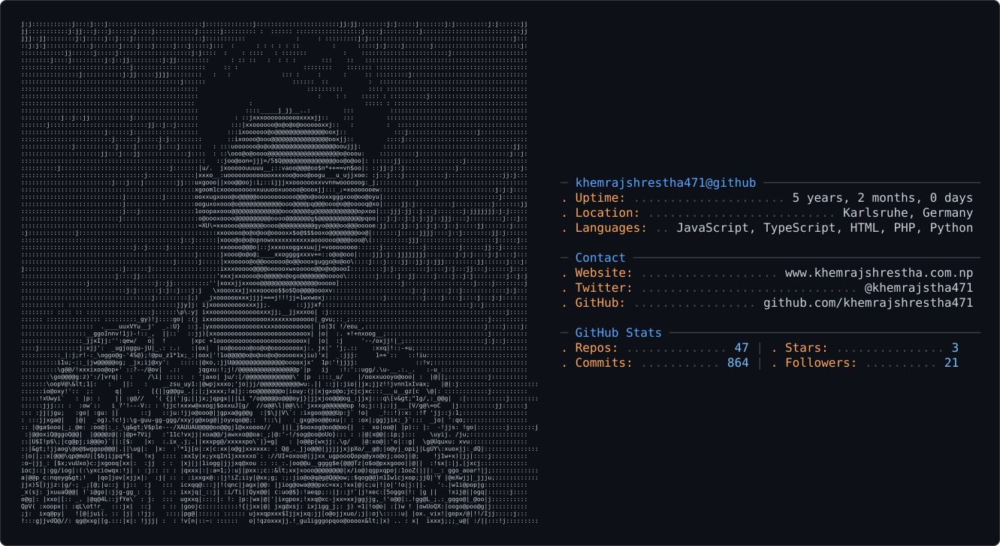

  

<picture>
  <source media="(prefers-color-scheme: dark)" srcset="dark_mode.svg" />
  <source media="(prefers-color-scheme: light)" srcset="light_mode.svg" />
  
</picture>

<!-- <h1 align="center">👋, Hey explorer!</h1> -->

### 🤖 I build agents that retrieve, not guess.

M.Sc. **Computer Science** student at **KIT (Karlsruhe Institute of Technology) 🇩🇪** and Registered Computer Engineer from **Nepal 🇳🇵**. I work where software engineering meets AI: **Agentic AI, RAG, LLM agents and scalable backends**, from research prototypes to production systems.

Off-screen, I play football ⚽, build communities, love solo travelling ✈️ and am a bit of an introvert (usually lost in a world of 0s and 1s 💻).

- 🔬 **Now:** Student Research Assistant at KIT (MCSE, KASTEL), building RAG-based knowledge graph tooling with Python, PostgreSQL and Docker  
- 🤖 **Previously:** Agentic AI workflows and secure RBAC APIs at **Fagoon AI**; scaled an AI proctoring platform to **500+ concurrent users** at **Fusemachines**  
- 🧠 **Thesis:** Liquid Neural Networks for edge audio classification, **97% fewer parameters** than a CNN baseline (🏆 Best Final Year Project)  
- 🌱 **Learning:** Reinforcement learning, vector databases and agent evaluation  
- 👯 **Open to:** AI / Software Engineering internships in Germany and open-source collaboration on AI agents  
- 💬 **Ask me about:** RAG, LLM agents, Celery + AWS SQS scaling, or model compression  
- 🎤 **Community:** Gold Microsoft Learn Student Ambassador, reaching 1,500+ developers through workshops and hackathons  
- 📫 **Find me:** &nbsp; &nbsp;  &nbsp;  &nbsp;  &nbsp; 🌐 <a href="https://www.khemrajshrestha.com.np/" target="_blank">khemrajshrestha.com.np</a>  
- 😄 **Pronouns:** he/him  
- ⚡ **Fun fact:** I build AI by day and still watch cartoons by night 📺  

### 🚀 Featured Projects

| Project | What it does | Highlights |
|---|---|---|
| 🧠 **Liquid Neural Networks for Edge Audio** | Audio classification for resource-constrained edge devices | 89.15% accuracy on UrbanSound8K · 97% fewer parameters |
| 📄 **DocuScan** | Document classification with OCR and an annotation tool | 94% accuracy · ResNet18 + Azure AI Vision · award-winning |
| 👁️ **FuseNirikshak** | Real-time AI exam proctoring | Whisper speech detection · MediaPipe gaze tracking · RBAC portal |

### 🧰 Tech Stack

**AI/ML:** LLM Agents · RAG · Knowledge Graphs · Computer Vision · Knowledge Distillation · Whisper · Optuna · MLflow  
**Backend:** Python · Node.js · Express · Django · REST APIs · OAuth 2.0 · Celery  
**Data:** PostgreSQL · MySQL · MongoDB · Redis  
**Frontend:** Next.js · React · TypeScript · Tailwind CSS  
**Cloud & DevOps:** Docker · AWS · Azure · CI/CD · Vercel

<!-- 

 -->
